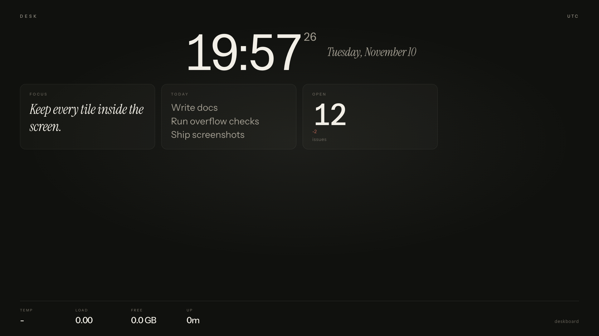
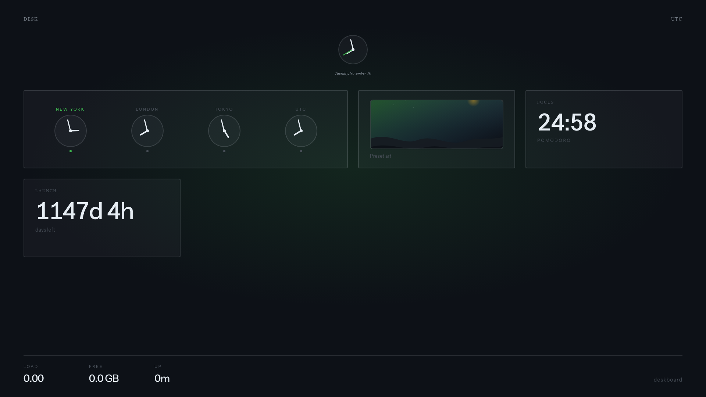
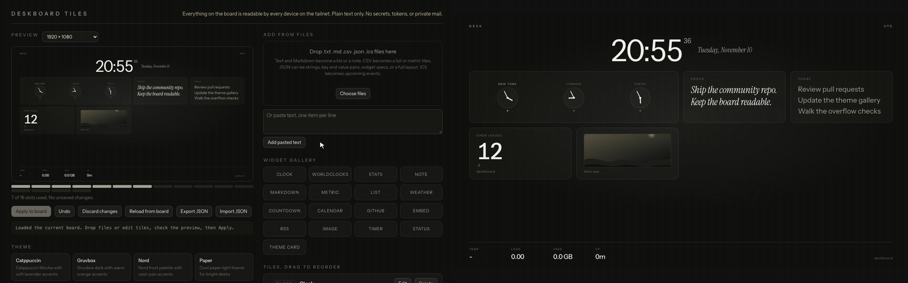
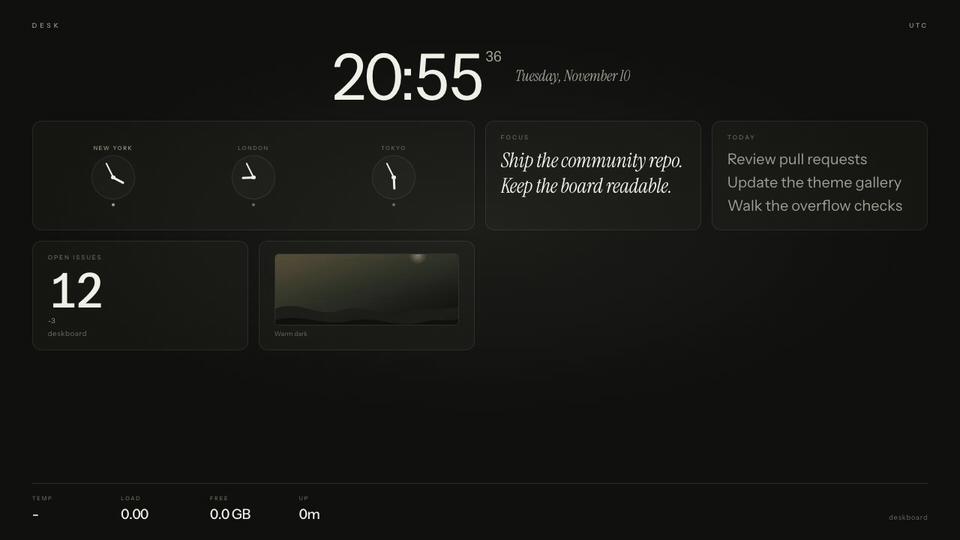

# Deskboard

A self-hosted desk dashboard for a spare mini PC and a monitor. It runs fullscreen in a kiosk browser, shows a tile grid that always fits the screen, and lets you edit the layout from another machine on your private network.





## See it in action

The configurator (`/?config`) on the left and the board on the right. Each edit goes to the board through the same API you can call with `curl`, and the board picks it up on its next 5 second refresh.



The board on its own, same four edits.



Higher quality video in [docs/media/demo-configurator-board.mp4](docs/media/demo-configurator-board.mp4). Rebuild all three with `bash scripts/record_demo.sh` (needs Node 22+, Chrome or Chromium, and ffmpeg).

### Examples

These start from the sample layout in `examples/demo-board.json` and match the animation step by step. In the configurator, tile edits stay pending until you press **Apply to board**, which sends the whole layout with `PUT /api/widgets/import`. The `curl` lines make the same change one route at a time.

**1. Move a tile.** Drag the Today card above World clocks under "Tiles, drag to reorder", then press Apply to board. Clock and Stats always stay first.

```bash
curl -s http://127.0.0.1:8730/api/widgets/order \
  -X PUT -H 'Content-Type: application/json' \
  -d '{"ids":["clock","stats","today","world","focus","metric1","themeart"]}'
```

**2. Add a world clock city.** Press Edit on World clocks and add a line to Cities in `Label|Timezone` form, here `Sydney|Australia/Sydney`. Send the full list on the API.

```bash
curl -s http://127.0.0.1:8730/api/widgets/world \
  -X PATCH -H 'Content-Type: application/json' \
  -d '{"cities":[
        {"label":"New York","zone":"America/New_York"},
        {"label":"London","zone":"Europe/London"},
        {"label":"Tokyo","zone":"Asia/Tokyo"},
        {"label":"Sydney","zone":"Australia/Sydney"}]}'
```

**3. Rewrite a list and make it taller.** Press Edit on Today, replace the items (one per line), and pick the 1×2 span button. Spans are `1` or `2` for both `col_span` and `row_span`.

```bash
curl -s http://127.0.0.1:8730/api/widgets/today \
  -X PATCH -H 'Content-Type: application/json' \
  -d '{"items":["Record the demo GIF","Tag v1.0","Water the plants"],"row_span":2}'
```

**4. Switch the theme.** Click Nord under Theme. This one saves right away with no Apply step.

```bash
curl -s http://127.0.0.1:8730/api/config \
  -X PATCH -H 'Content-Type: application/json' \
  -d '{"theme":"nord"}'
```

`GET /api/themes` lists every theme id. Full route list in [docs/api.md](docs/api.md).

## Quick start (any OS)

Needs Python 3.10+.

```bash
cp config.example.json config.json
python3 serve.py
```

The clock follows the host machine's timezone. Set `timezone` in `config.json` or in the configurator to override it with an IANA name, or leave it as `auto`.

Open:

- Board: `http://127.0.0.1:8730`
- Configurator: `http://127.0.0.1:8730/?config`

No build step. The page is plain HTML, CSS, and JS with fonts vendored under `web/fonts/`.

Load the sample layout:

```bash
curl -s http://127.0.0.1:8730/api/widgets/import \
  -X PUT -H 'Content-Type: application/json' \
  --data-binary @examples/demo-board.json
```

## Build your own tile

Each tile type outside the built-in set is one folder under `tiles/` with a `tile.json`, a `render.js`, an optional `tile.css`, and a `README.md`. The server finds the folders at startup, so adding a tile means adding a folder.

```bash
scripts/new_tile.sh my_tile
```

Run `scripts/reload.sh` and open `http://127.0.0.1:8730/?tilepreview=my_tile` to see it at every span. Contributed tiles go under `tiles/community/` and stay off until you list them in `enabled_community_tiles`. The full guide is [docs/tiles.md](docs/tiles.md), and the checklist is in [CONTRIBUTING.md](CONTRIBUTING.md).

### Reloading

`scripts/reload.sh` tells a running server to rescan `tiles/`. It prints what loaded and what was skipped, and the board picks up the change within 5 seconds. The configurator has a **Reload tiles** button that does the same, and `POST /api/reload` is the API route behind both. A broken tile folder is skipped without touching the others. Restart the service only after changing server Python files (`sudo systemctl restart deskboard` on Ubuntu). See [docs/tiles.md](docs/tiles.md#reloading).

## Let your bots post

Mark a list tile with `"managed_by": "bots"` and any script or assistant can add a line to it.

```bash
scripts/post.sh botstatus Backup "Nightly backup finished"
```

The configurator keeps a managed tile's content read-only and refuses to apply over a newer layout. [How to get your bot to update your Deskboard](docs/bots.md#how-to-get-your-bot-to-update-your-deskboard) has the curl call and a prompt you can paste into any AI assistant. For assistants that speak MCP, [docs/mcp.md](docs/mcp.md) sets up the Deskboard MCP server, which can post status lines and read tiles and nothing else.

## Install as a desk kiosk (Ubuntu)

See [docs/install-ubuntu.md](docs/install-ubuntu.md). Short version:

```bash
sudo DESKBOARD_USER="$USER" ./install.sh
```

That installs Cage + WebKitGTK, writes systemd units, and starts the board on the attached display.

## What you get

- Tile grid that stays inside the viewport from 1024x600 up to 4K, including portrait
- Drag-and-drop configurator: drop files, reorder tiles, resize spans, live preview
- Themes (warm dark default, plus Tokyo Night, Catppuccin, Gruvbox, Nord, Rose Pine, Tiling, Paper)
- Tile catalog under `tiles/` with a scaffold script, a preview page, and off-by-default community tiles
- Widgets for notes, lists, metrics, markdown, weather, countdown, ICS calendar, GitHub stars, embeds, RSS, images, timers, URL status, world clocks, and theme art cards
- Stdlib Python server. No CORS. Loopback by default. Optional Tailscale bind

## Security in one paragraph

Anything on the board is readable by every device that can reach the port. Keep it on loopback or a Tailscale tailnet. Do not bind `0.0.0.0`. Do not put secrets, tokens, or private mail in tiles. Embed hosts must be allowlisted. Details: [docs/security.md](docs/security.md).

## Docs

- [API reference](docs/api.md)
- [Widget reference](docs/widgets.md)
- [Tile catalog](docs/tiles.md)
- [Bots and managed tiles](docs/bots.md), including how to get your bot to update your Deskboard
- [MCP server](docs/mcp.md)
- [Theme guide](docs/themes.md)
- [Ubuntu kiosk install](docs/install-ubuntu.md)
- [Security](docs/security.md)
- [Contributing](CONTRIBUTING.md)

## Tests

```bash
python3 -m unittest discover -s tests -v
bash scripts/run_overflow.sh
```

Overflow checks need Google Chrome or Chromium. Screenshots land in `shots/`.

## License

MIT. Instrument Sans and Instrument Serif ship under the SIL Open Font License in `web/fonts/`.
